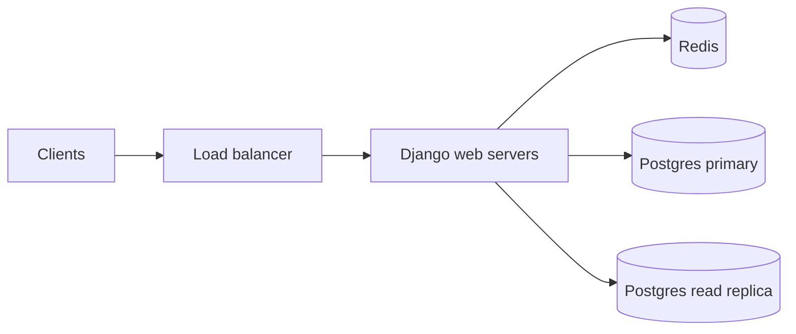

My team runs a multi-tenant Django API, and for years we scaled it the usual ways: a bigger Postgres primary, then a read replica, plus a few cautious caches with short TTLs and patchy invalidation. Then traffic grew about 20x in two years, and what carried that load was caching deliberately and aggressively.



## Why caching, and where to start

Our database CPU kept running hot. Each fix we tried bought some time before the database was overloaded again:

- **[Query tuning]()** helped at first, but at some volume even a well-tuned query is too expensive to run thousands of times a second.
- **Scaling up to a bigger primary** is a one-time, expensive bump in headroom that growth soon consumes.
- **Scaling out with read replicas** still runs every query and adds replication-lag bugs.
- **Postgres's own cache** holds pages and indexes, not query results, so a hot read still burns CPU on every call even when everything it touches is in memory.

Caching was different: it removes work instead of adding capacity.

To find the worst offenders, rank queries by total database time, not per-query latency. A 2 ms query running thousands of times a second burns more database time than a 500 ms query running once a minute. A production CPU profile of our web processes agreed: the hot paths were the high-volume ones. Work the list top down. For us that meant whole endpoint responses first.

## Cache globally, assemble per user

One cached response per user is the obvious shape:

```python
def document_list(user):
    return get_or_set(
        f"user:{user.id}:documents", lambda: serialize(visible_documents(user))
    )
```

```text
# Redis: one copy per user
user:1:documents -> [{id: A, title: "Roadmap", can_edit: true},  {id: B, title: "Budget", can_edit: true}]
user:2:documents -> [{id: A, title: "Roadmap", can_edit: false}]
user:N:documents -> [{id: A, title: "Roadmap", can_edit: false}, {id: B, title: "Budget", can_edit: false}]
```

This breaks down when users share data. In a workspace where thousands of users see the same documents, each document is copied into every user's key, so renaming one invalidates every copy, and they all refill at once.

Split the response into two tiers instead:

1. **Per user:** the IDs of the documents this user can see, the expensive permission query.
2. **Global:** one serialized base per document, shared by everyone.

Fetch the user's document IDs, fetch those document bases in one `get_many`, and assemble:

```python
def document_list(user):
    doc_ids = get_or_set(f"user:{user.id}:doc-ids", lambda: visible_doc_ids(user))
    bases = get_or_set_many(
        doc_ids, key=lambda doc_id: f"doc:{doc_id}", build=build_base
    )
    group_ids = cached_group_ids(user)
    return [
        {
            **base,
            "can_edit": (
                base["owner_id"] == user.id
                or bool(base["editor_group_ids"] & group_ids)
            ),
        }
        for base in bases
    ]
```

```text
# Redis: one copy per document
user:1:doc-ids -> [A, B]
user:2:doc-ids -> [A]
user:N:doc-ids -> [A, B]
doc:A          -> {id: A, title: "Roadmap", owner_id: 1, editor_group_ids: {7}}
doc:B          -> {id: B, title: "Budget", owner_id: 1, editor_group_ids: set()}
```

A warm cache never touches the database, and invalidation shrinks from thousands of keys to one: renaming a document clears `doc:A` instead of every user's copy.

This trades one database query for a few Redis calls, which is fine: a Redis call is far cheaper than even a trivial Postgres query. Cheaper is not free, though, so keep the call count down: batch with `get_many` and `set_many`, and guard against cache N+1s with an [`assertNumQueries`](#sanity-check-query-counts-in-units-tests-with-assertnumqueries) equivalent for cache calls; we wrote one called `assertNumCacheCalls`.

One rule keeps this safe: **the shared base must not depend on who is asking.** The trap is a field like `can_edit`. Serialize it for the requesting user and the first user to warm the cache decides for everyone. Store the inputs instead (owner, editor group IDs) and compute `can_edit` at assembly from the user's cached groups.

## Long TTLs, precise invalidation

Short TTLs feel safe because the data refreshes often, so a missed invalidation heals on its own. Django's cache [defaults to five minutes](https://docs.djangoproject.com/en/6.1/ref/settings/#timeout). At scale, that is wrong in both directions:

- **Too short for the hot path.** Entries expire while users are away, so when a thousand users start a shift together, every request misses at once and the refill overloads the database.
- **Too long for writes.** A user who creates a document expects to see it immediately, not five minutes later.

So invalidation has to be correct anyway. We invalidate immediately on writes with [Django signals](https://docs.djangoproject.com/en/6.1/topics/signals/) and run seven-day TTLs. The exact number depends on your workload; we chose seven days over thirty so entries nobody reads anymore age out instead of bloating Redis. A missed invalidation can leave stale data in Redis for days, so we treat invalidation bugs seriously and test for them explicitly:

- Every Django signal has a test asserting that its write clears the right keys.
- Cold and warm query counts are pinned with `assertNumQueries`, so a cache that quietly starts hitting the database fails the suite.
- A [Hypothesis state machine](https://hypothesis.readthedocs.io/en/latest/stateful.html) runs random sequences of writes and asserts after each one that the cached response equals the uncached one. It caught real bugs before production and doubles as a cross-user leak check.

More invalidation lessons:

- **Block writes that skip Django signals.** Covered in [its own post]().
- **Invalidate after commit** with [`transaction.on_commit`](https://docs.djangoproject.com/en/6.1/topics/db/transactions/#performing-actions-after-commit). Clear a key mid-transaction and a concurrent request re-caches the pre-commit rows.
- **Rebuild from the primary.** A refill from the replica can store rows replication has not caught up to.
- **Keep bases flat.** The natural shape is a document base that embeds its folder, the way a nested serializer would. But then renaming a folder must invalidate every document in it, and every nested model adds another edge for invalidation to follow. Store `folder_id` instead, cache folders under their own key, and join them at assembly. It costs one more Redis call per request, and in return a write to any model clears only that model's keys.

## Limit the invalidation blast radius

Some writes invalidate far more keys than they should, and every cleared key is a refill the database pays for on that user's next request. A large customer once edited one row that thousands of its users read. Our Django signal handler cleared every key for every one of them, and the thundering herd of refills overloaded the database and degraded the API for several minutes.

The fix was discipline: invalidate only the keys that changed and prefer global keys over per-user keys, which is what the [two-tier design](#cache-globally-assemble-per-user) buys.

The exception is fleet-wide changes, like flipping a feature flag from nobody to everybody. Clearing one key per user, for every user, is exactly the storm we avoid, so those caches skip invalidation and rely on a short TTL. Our per-user feature flag cache, for example, expires after an hour. We accept the slow rollout and keep an admin "clear cache" button for when a change can't wait.

## Cache the identity lookup

Every authenticated request looks up who is asking before any view runs. Whatever the credential (session cookie, JWT, API token), that lookup ends in a database read for the user row. Our session lookup was trivially cheap per call and still a top-five query by total time. Cache it, and invalidate on deactivation or revocation.

For sessions, set `SESSION_ENGINE` to Django's [`cached_db` backend](https://docs.djangoproject.com/en/6.1/topics/http/sessions/#using-cached-sessions) and the cookie-to-user-ID step comes from the cache. Caching the user row is up to you.

## Plan for Redis going down

Once most reads come from Redis, the database can no longer carry the full load without it. A Redis outage has two halves to plan for: surviving the first few minutes, and finding out fast.

To survive them, fail open. With [django-redis](https://github.com/jazzband/django-redis), a cache error falls through to the database instead of returning a 500:

```python
CACHES = {
    "default": {
        "BACKEND": "django_redis.cache.RedisCache",
        "LOCATION": "redis://...",
        "OPTIONS": {
            "SOCKET_CONNECT_TIMEOUT": 1,  # seconds
            "SOCKET_TIMEOUT": 1,
        },
    }
}
DJANGO_REDIS_IGNORE_EXCEPTIONS = True
DJANGO_REDIS_LOG_IGNORED_EXCEPTIONS = True
```

- [`DJANGO_REDIS_IGNORE_EXCEPTIONS`](https://github.com/jazzband/django-redis#memcached-exceptions-behavior) treats connection errors and timeouts as cache misses, so reads go to the database and writes are skipped.
- [`DJANGO_REDIS_LOG_IGNORED_EXCEPTIONS`](https://github.com/jazzband/django-redis#log-ignored-exceptions) logs the swallowed errors, so you can alert on them.
- [Socket timeouts](https://github.com/jazzband/django-redis#socket-timeout) cap how long each call waits on a dead Redis. Keep them short, but not so short that a healthy TLS handshake misses them.

Failing open only buys time. Every request still pays the timeout on each cache call, and if Redis stays down, all of that traffic lands on the database you were caching to protect.

So find out fast. Monitor Redis like the database: the [four golden signals](https://sre.google/sre-book/monitoring-distributed-systems/#xref_monitoring_golden-signals) (latency, traffic, errors, saturation) plus hit rate and evicted keys, with thresholds low enough to give warning time. It has paid off many times, most memorably when our cloud provider's maintenance starved Redis of CPU and knocked it offline, and we knew within minutes.

## Results

During the three-month rollout, traffic rose about 40% while average latency fell about 40%, database queries per second halved, and web CPU halved on fewer servers.

Today the API peaks around 1,100 requests per second on a typical weekday, and it once hit 2,300 when a large customer pushed an update to all of its users simultaneously. Postgres sees about 0.3 queries per request, and Redis serves most reads at a 97% hit rate. Traffic has kept growing since the rollout and database load has not. Redis absorbs the growth instead.

If you can see growth coming, start caching deliberately before the database forces you to. We waited longer than we should have.
