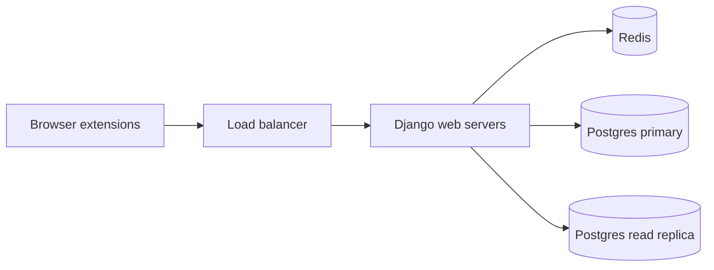

My team runs a multi-tenant Django API that serves browser extensions. Traffic arrives in waves: a company's employees all log on in the same minute, or a customer pushes an update to every user at once. Traffic grew about 20x in two years. The API peaks around 1,100 requests per second on a typical weekday. The busiest moment we have seen, a large customer pushing an update to all of its users at once, hit 2,000. Postgres sees about 0.3 queries per request. Redis serves the rest at a 97% hit rate. Caching was the biggest lever, and here is what we learned.

The stack: Django and Django REST Framework, Postgres with a read replica, Redis through [django-redis](https://github.com/jazzband/django-redis), and web servers behind a load balancer.



## Cache when nothing cheaper works

Caching is the answer when database CPU is saturated and nothing simpler will relieve it. For us, each alternative fell short:

- **[Query tuning]()** helped at first, but at some volume even a well-tuned query is too expensive to run thousands of times a second.
- **Postgres's own cache** holds pages and indexes, not query results, so a hot read still burns CPU on every call even when everything it touches is in memory.
- **Scaling up to a bigger primary** is a one-time, expensive bump in headroom that growth soon consumes.
- **Scaling out with read replicas** still runs every query and adds replication-lag bugs.

Rank queries by total database time, not per-query latency. A 2 ms query running thousands of times a second burns more database time than a 500 ms query running once a minute. A production CPU profile of our web processes agreed: the hot paths were the high-volume ones. Work the list top down. For us that meant whole endpoint responses first.

## Cache globally, assemble per user

One cached response per user is the obvious shape:

```python
def document_list(user):
    return get_or_set(
        f"user:{user.id}:documents", lambda: serialize(visible_documents(user))
    )
```

```text
# Redis: one copy per user
user:1:documents -> [{id: A, title: "Roadmap", can_edit: true},  {id: B, ...}]
user:2:documents -> [{id: A, title: "Roadmap", can_edit: false}]
user:N:documents -> [{id: A, title: "Roadmap", can_edit: false}, {id: B, ...}]
```

It breaks down when users share data. In a workspace where thousands of users see the same documents, that is thousands of copies, and renaming one document invalidates thousands of keys that all refill at once.

Split the response into two tiers instead:

1. **Per user:** the IDs of the documents this user can see, the expensive permission query.
2. **Global:** one serialized base per document, shared by everyone.

Fetch the user's document IDs, fetch those document bases in one `get_many`, and assemble:

```python
def document_list(user):
    doc_ids = get_or_set(f"user:{user.id}:doc-ids", lambda: visible_doc_ids(user))
    bases = get_or_set_many(
        doc_ids, key=lambda doc_id: f"doc:{doc_id}", build=build_base
    )
    group_ids = cached_group_ids(user)
    return [
        {
            **base,
            "can_edit": (
                base["owner_id"] == user.id
                or bool(base["editor_group_ids"] & group_ids)
            ),
        }
        for base in bases
    ]
```

```text
# Redis: one copy per document
user:1:doc-ids -> [A, B]
user:2:doc-ids -> [A]
user:N:doc-ids -> [A, B]
doc:A          -> {id: A, title: "Roadmap", owner_id: 1, editor_group_ids: [7]}
doc:B          -> {...}
```

A warm cache never touches the database, and invalidation is proportional to what changed: renaming a document clears `doc:A`, one key instead of one per user.

This trades one database query for three Redis calls, and that is a good trade: a Redis call is far cheaper than even a trivial Postgres query. Cheaper is not free, though, so keep the call count down: batch with `get_many` and `set_many`, and guard against cache N+1s with an `assertNumQueries` equivalent for cache calls; we wrote one called `assertNumCacheCalls`.

One rule keeps this safe: **the shared base must not depend on who is asking.** The trap is a field like `can_edit`. Serialize it for the requesting user and the first user to warm the cache decides for everyone. Store the inputs instead (owner, editor group IDs) and compute `can_edit` at assembly from the user's cached groups. Copy the base rather than mutating it; every other request shares it.

## Long TTLs, precise invalidation

Short TTLs feel safe because the data refreshes often, so a missed invalidation heals on its own. Django's cache [defaults to five minutes](https://docs.djangoproject.com/en/6.1/ref/settings/#timeout). At scale, that is wrong in both directions:

- **Too short for the hot path.** When a thousand users start a shift together, their entries all expired while they were away, and the refill overloads the database.
- **Too long for writes.** A user who creates a document expects to see it immediately, not five minutes later.

So invalidation has to be correct anyway. We invalidate immediately on writes with [Django signals](https://docs.djangoproject.com/en/6.1/topics/signals/) and run seven-day TTLs. The exact number depends on your workload; seven days rather than thirty worked for us so that entries nobody reads anymore age out instead of bloating Redis. With a long TTL a missed invalidation lives for a week, so it is a bug, and we test for it like one:

- Every Django signal has a test asserting that its write clears the right keys.
- Cold and warm query counts are pinned with [`assertNumQueries`](#sanity-check-query-counts-in-units-tests-with-assertnumqueries), so a cache that quietly starts hitting the database fails the suite.
- A [Hypothesis](https://hypothesis.readthedocs.io/) state machine runs random sequences of writes and asserts after each one that the cached response equals the uncached one. It caught real bugs before production and doubles as a cross-user leak check.

More invalidation lessons, each learned the hard way:

- **Block writes that skip Django signals.** Covered in [its own post]().
- **Invalidate after commit** with [`transaction.on_commit`](https://docs.djangoproject.com/en/6.1/topics/db/transactions/#performing-actions-after-commit). Clear a key mid-transaction and a concurrent request re-caches the pre-commit rows.
- **Rebuild from the primary.** A refill from the replica can store rows replication has not caught up to.
- **Keep bases flat.** The natural shape is a document base that embeds its owner, the way a nested DRF serializer would. But then a user changing their name must invalidate every document they own, and every nested model adds another edge for invalidation to follow. Store `owner_id` instead, cache owners under their own key, and join them at assembly. It costs one more Redis call per request to fetch all the owner payloads, and in return a write to any model clears only that model's keys.

## Limit the invalidation blast radius

Some writes invalidate far more keys than they should, and every cleared key is a refill the database pays for on that user's next request. Early on, a large customer edited one row that thousands of its users read. Our Django signal handler cleared every key for every one of them, and the thundering herd of refills overloaded the database and degraded the API for several minutes.

The fix was discipline: invalidate only the keys that changed, skip writes that change nothing, and prefer global keys over per-user keys, which is what the two-tier design above buys.

The exception is fleet-wide changes, like flipping a feature flag from nobody to everybody. Clearing one key per user, for every user, is exactly the storm we avoid, so those caches keep a short TTL (one hour for flags) instead. We accept the slow rollout and keep an admin "clear cache" button for when someone needs it now.

We have no protection against cache stampedes, where concurrent misses all rebuild one hot key at once. It has happened and never hurt, so for now we monitor for it and will add locking if growth changes that.

## Cache the identity lookup

Every authenticated request resolves who is asking before any view runs, so this lookup runs more often than anything else.

Whatever the credential, validating it ends with a user row: a session cookie resolves to a user ID, a JWT's subject still needs a row after the signature check, an opaque token needs a token-to-user lookup. Cache that step and invalidate on deactivation or revocation. Our session query looked trivially cheap per call but was a top-five query by total time.

For session auth, Django handles the first half for you: set `SESSION_ENGINE` to the [`cached_db` backend](https://docs.djangoproject.com/en/6.1/topics/http/sessions/#using-cached-sessions) and the lookup from cookie to user ID comes from the cache, falling back to the database. The lookup from user ID to user row is yours to cache.

## Redis is now critical infrastructure

Once most reads come from Redis, it is no longer an optimization. Monitor it like the database: the [four golden signals](https://sre.google/sre-book/monitoring-distributed-systems/#xref_monitoring_golden-signals) (latency, traffic, errors, saturation) plus hit rate and evicted keys, with thresholds low enough to give warning time. Run it highly available.

Fail open. [`DJANGO_REDIS_IGNORE_EXCEPTIONS = True`](https://github.com/jazzband/django-redis#memcached-exceptions-behavior) with a short socket timeout turns a Redis outage into database reads instead of errors, and the error-rate alert tells you it happened. The caveat: fail-open only buys time. Every request still pays the timeout on each cache call, and if Redis stays down, all of that traffic lands on the database you were caching to protect.

Redis did stall on us once, when a maintenance process run by our cloud provider saturated the Redis host's CPU. The monitoring told us something was wrong within minutes. We investigated, reported it to the provider, and they fixed it promptly.

## Results

During the three-month rollout, traffic rose about 40% while average latency fell about 40%, database queries per second halved, and web CPU halved on fewer servers. Traffic has kept growing since, and database load has not. Redis comfortably absorbs the growth instead.

The short version: cache the shared thing once, keep the per-user part small, invalidate exactly what changed, and treat Redis like the database it now protects.
