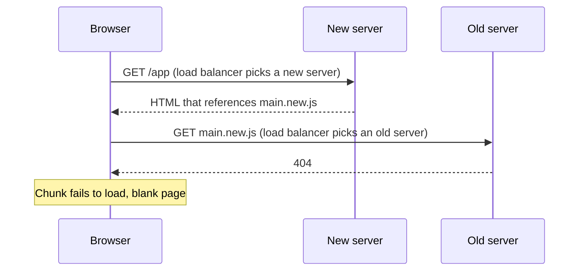
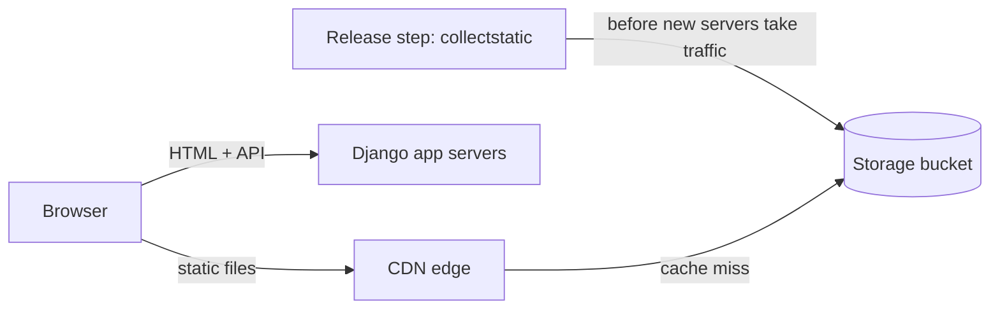

My team's Django app renders the HTML for a React SPA, and [WhiteNoise](https://whitenoise.readthedocs.io/en/stable/django.html) used to serve its JavaScript and CSS from the same app servers. When we moved from blue-green to rolling deploys, some users got a blank page during every deploy. The problem is called [version skew](https://www.industrialempathy.com/posts/version-skew/): the code in the browser and the code on the server come from different releases. The fix is to decouple static files from the app servers: upload every build's files to shared storage and serve them from a CDN.

## Version Skew in a Rolling Deploy

A rolling deploy is a common zero-downtime strategy: it replaces servers a few at a time, so old and new releases serve traffic side by side for several minutes. The load balancer routes every request independently.

Bundlers like webpack and Vite name each file after a hash of its contents, like `main.3f9a1c.js`, so every build that changes a file gives it a new name. Call them `main.old.js` and `main.new.js`. Each server only has its own release's files:



The reverse fails the same way: old HTML asks a new server for `main.old.js`.

This isn't just an SPA problem. If you use Django's [`ManifestStaticFilesStorage`](https://docs.djangoproject.com/en/6.1/ref/contrib/staticfiles/#manifeststaticfilesstorage), directly or through WhiteNoise, your own CSS and JavaScript get hashed names too. So server-rendered templates and [htmx](https://htmx.org/) apps get the same 404 when new HTML asks an old server for `styles.new.css`.

Open tabs are the hardest case. With [code splitting](https://developer.mozilla.org/en-US/docs/Glossary/Code_splitting), the app downloads parts of its code only when the user needs them, so a tab opened before the deploy requests `chunk.old.js` long after every old server is gone.

The problem is common enough that [Vercel](https://vercel.com/docs/skew-protection) and [Netlify](https://www.netlify.com/blog/introducing-netlify-skew-protection) built skew protection into their hosting: they keep old deployments alive and route each page's requests to the deployment that served it. That only helps apps they host, so when Django serves your SPA, the fix is up to you.

## Fixes That Fall Short

- **Blue-green (atomic) deploys.** This is what we had before: start a full new fleet, then switch all traffic at once. Errors were rare, but open tabs still broke after the switch. And while both fleets ran, each held its own database connections, which pushed us up against our database's connection limit on every deploy.
- **Sticky sessions.** The load balancer pins each browser to one server with a cookie. That makes the bug rarer, not gone: when a deploy replaces your old server, your next request lands on a new one, and the page you already loaded still asks it for old files.
- **Reloading when a chunk fails to load.** Catch the error (`ChunkLoadError` in webpack, `vite:preloadError` in Vite) and reload the page. It's a good safety net for flaky networks, but it throws away the user's state, and mid-rollout the reload can land on the wrong server again.
- **WhiteNoise behind a CDN.** [WhiteNoise's docs](https://whitenoise.readthedocs.io/en/stable/django.html#use-a-content-delivery-network) recommend it: the CDN caches static files at the edge, so files it has already cached survive a deploy. But a cache miss for `main.new.js` can still land on an old server and get a 404. Worse, the CDN can cache that 404 for everyone.

They all fall short for the same reason: each server only has its own release's files.

## Keep Every Build's Files in Shared Storage

Shared storage is one bucket that every release writes to and the CDN reads from, so it outlives any single release. Two rules make it work:

1. Upload in a CI/CD release step that runs before any new server takes traffic, so new HTML never references a file that isn't there yet.
2. Keep old files as long as anything might still request them, so old HTML and open tabs always find theirs.



Content-hashed names pay off here. A file that didn't change keeps its name across releases, so it doesn't need re-uploading and browsers keep it cached. Per-release folders (`/static/<release>/main.js`) also work with shared storage, but every deploy changes every URL, so users re-download everything.

Don't clean up with an S3 [lifecycle rule](https://docs.aws.amazon.com/AmazonS3/latest/userguide/intro-lifecycle-rules.html). It expires objects by upload age, and with the setup below an unchanged file is uploaded only once, so the rule would eventually delete files the current build still uses. We keep everything, which costs us pennies a month.

## The Django Side

A small [django-storages](https://django-storages.readthedocs.io/en/latest/index.html) class, plus `STATIC_URL` as the switch:

```python
# config/storage.py
from storages.backends.s3 import S3ManifestStaticStorage


class StaticStorage(S3ManifestStaticStorage):
    def stored_name(self, name):
        # The bundler already hashed these files, so skip Django's manifest (see below)
        if name.startswith("frontend/"):
            return name
        return super().stored_name(name)


# settings.py
import os
from urllib.parse import urlparse

# Production: "https://static.example.com/" (bucket + CDN)
# Local: "/static/" (Django's defaults, no bucket)
STATIC_URL = os.environ["STATIC_URL"]

STATICFILES_DIRS = [("frontend", BASE_DIR / "frontend" / "dist")]  # bundler output

STORAGES = {
    "default": {"BACKEND": "django.core.files.storage.FileSystemStorage"},
    "staticfiles": {"BACKEND": "django.contrib.staticfiles.storage.StaticFilesStorage"},
}

if cdn_domain := urlparse(STATIC_URL).netloc:
    STORAGES["staticfiles"] = {
        "BACKEND": "config.storage.StaticStorage",  # the class above
        "OPTIONS": {
            "bucket_name": os.environ["STATIC_BUCKET_NAME"],  # collectstatic uploads here
            "custom_domain": cdn_domain,  # link to the CDN, not the bucket
        },
    }
```

The `stored_name` override fixes a Django-specific gotcha: the manifest, `staticfiles.json`, now lives in the bucket too, and every deploy overwrites it. Loaders like [django-webpack-loader](https://github.com/django-webpack/django-webpack-loader) and [django-vite](https://github.com/MrBin99/django-vite) turn bundle names into URLs through that manifest. If a worker on an old server restarts mid-deploy, it loads the new manifest, can't find its old bundle's name, and raises `Missing staticfiles manifest entry`: a 500. Bundler output is already hashed, so the override serves it by its own names and never asks the manifest.

Add [collectfasta](https://github.com/jasongi/collectfasta) as well. On a fresh CI build, stock [`collectstatic`](https://docs.djangoproject.com/en/6.1/ref/contrib/staticfiles/#collectstatic) re-uploads every file one at a time, while collectfasta uploads only the changed files, in parallel. That cut our upload from over an hour to seconds.

## Serving It From Amazon CloudFront

We already ran CloudFront for another asset domain, so we reused it. Any CDN that can serve a bucket works, since Django only sees `STATIC_URL`. The settings worth getting right:

- **Private bucket.** Block public access and let only the distribution read it, with [Origin Access Control](https://docs.aws.amazon.com/AmazonCloudFront/latest/DeveloperGuide/private-content-restricting-access-to-s3.html).
- **Compression and edge caching.** Turn on compression and use the managed [`CachingOptimized`](https://docs.aws.amazon.com/AmazonCloudFront/latest/DeveloperGuide/using-managed-cache-policies.html#managed-cache-caching-optimized) policy, which caches Brotli and gzip versions at the edge.
- **Immutable browser caching.** Give hashed files a long-lived [`immutable`](https://developer.mozilla.org/en-US/docs/Web/HTTP/Reference/Headers/Cache-Control#immutable) `Cache-Control` header with a [response headers policy](https://docs.aws.amazon.com/AmazonCloudFront/latest/DeveloperGuide/modifying-response-headers.html), so repeat visits skip revalidation. Keep unhashed files on a short TTL.
- **No cache invalidations.** Changed content always gets a new hashed name, so a deploy never has to purge the cache.
- **CORS.** Fonts and JavaScript modules from another domain need CORS headers. Add them with a response headers policy.

## What's Next

Infrastructure as code. Defining the bucket, distribution, and DNS records in a tool like Terraform makes every environment identical and every change reviewable.

The short version: upload every build's files to shared storage before the release takes traffic, keep them while anything might still need them, and let the CDN do the rest.
