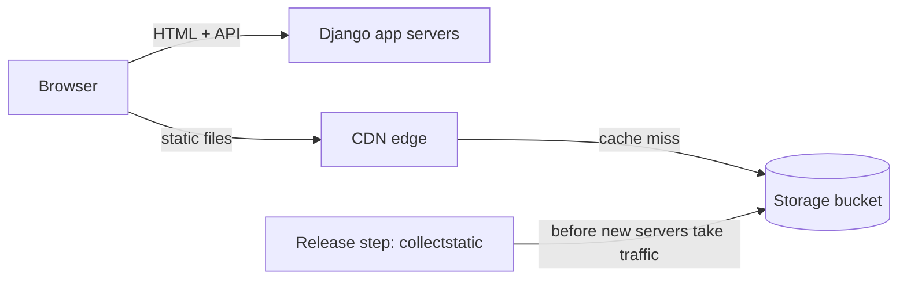

My team's Django app serves a React SPA. Django renders the HTML shell, and [WhiteNoise](https://whitenoise.readthedocs.io/en/stable/django.html) served the JavaScript and CSS from the same app servers:

```python
STORAGES = {
    # ...
    "staticfiles": {
        "BACKEND": "whitenoise.storage.CompressedManifestStaticFilesStorage",
    },
}
```

That worked while our deploys switched all traffic to the new release at once. When we moved to rolling deploys, old and new releases overlapped for minutes instead of seconds, and some users got a blank page during every deploy. The problem is called [version skew](https://www.industrialempathy.com/posts/version-skew/): two releases running at once and disagreeing. It's the same problem behind [multistep database changes](), this time with static files. The fix is to take them out of the deploy entirely.

## Version Skew in a Rolling Deploy

A rolling deploy replaces servers a few at a time, so old and new releases serve traffic side by side for several minutes. The load balancer routes every request independently.

Webpack names each file after a hash of its contents, like `main.3f9a1c.js`, so browsers can cache it forever and every build that changes a file gives it a new name. Call them `main.old.js` and `main.new.js`. Each server only has its own release's files:


The reverse fails the same way: old HTML asks a new server for `main.old.js`.

Open tabs are the hardest case. With [code splitting](https://webpack.js.org/guides/code-splitting/), the app downloads parts of its code only when the user needs them, so a tab opened before the deploy requests `chunk.old.js` long after every old server is gone.

The problem is common enough that Vercel built [Skew Protection](https://vercel.com/docs/skew-protection) into its hosting: it keeps old deployments alive and routes each page's requests to the deployment that served it. When Django serves your SPA, the fix is up to you.

## Fixes That Don't Work on Their Own

- **Sticky sessions.** The load balancer pins each browser to one server with a cookie. That makes the bug rarer, not gone: the first request isn't pinned yet, a deploy replaces the server you're pinned to, and open tabs still ask new servers for old files.
- **Blue-green (atomic) deploys.** This is what we had before: start a full new fleet, then switch all traffic at once. Errors were rare, but open tabs still broke after the switch. And while both fleets ran, each held its own database connections, which pushed us up against our database's connection limit on every deploy.
- **Reloading on `ChunkLoadError`.** Catch the error and reload the page. It's a good safety net for flaky networks, but it throws away the user's state, and mid-rollout the reload can land on the wrong server again.
- **A CDN in front of the app servers.** [WhiteNoise's docs](https://whitenoise.readthedocs.io/en/stable/django.html#use-a-content-delivery-network) recommend it, and it gets close. But a cache miss for `main.new.js` still goes to whichever server the load balancer picks, and CloudFront [caches that 404](https://docs.aws.amazon.com/AmazonCloudFront/latest/DeveloperGuide/HTTPStatusCodes.html) for 10 seconds by default, for everyone at that edge.

The CDN isn't the problem. Where the files live is.

## Keep Every Build's Files in Shared Storage

Take static files out of the deploy. Every release uploads its files to shared storage: one bucket that every release writes to and every request reads from, which outlives any single release. A CDN serves the bucket. Two rules make it work:

1. Upload in a release step that runs before any new server takes traffic, so new HTML never references a file that isn't there yet.
2. Keep old files as long as anything might still request them, so old HTML and open tabs always find theirs.



Content-hashed names pay off here. A file that didn't change keeps its name across releases, so it's never re-uploaded and browsers keep it cached. Per-release folders (`/static/<release>/main.js`) also work with shared storage, but every deploy changes every URL, so users re-download everything.

Deleting old files safely is harder than it looks. An S3 [lifecycle rule](https://docs.aws.amazon.com/AmazonS3/latest/userguide/intro-lifecycle-rules.html) expires objects by upload age, and an unchanged file is never re-uploaded, so it would delete files the current build still uses. A safe cleanup keeps every file that recent releases reference and deletes the rest after a grace period. We skipped that and keep everything. For us that costs pennies a month; a site with more or larger files will pay more, but storage is cheap.

## The Django Side

`STATIC_URL` becomes the switch, and one small storage class handles the rest:

```python
# settings.py
import os
from urllib.parse import urlparse

STATIC_URL = os.environ["STATIC_URL"]  # "https://static.example.com/" or "/static/"
STATICFILES_DIRS = [("bundles", BASE_DIR / "frontend" / "dist")]  # webpack output

STORAGES = {
    "default": {"BACKEND": "django.core.files.storage.FileSystemStorage"},
    "staticfiles": {"BACKEND": "django.contrib.staticfiles.storage.StaticFilesStorage"},
}

# An absolute STATIC_URL (one with a domain) turns on CDN mode: collectstatic
# uploads to the bucket and templates link to the CDN. A relative one keeps
# Django's defaults, so local development needs no bucket.
if urlparse(STATIC_URL).netloc:
    STORAGES["staticfiles"] = {
        "BACKEND": "config.storage.StaticStorage",
        "OPTIONS": {
            "bucket_name": os.environ["STATIC_BUCKET_NAME"],
            "custom_domain": urlparse(STATIC_URL).netloc,  # link to the CDN, not S3
        },
    }


# config/storage.py
from storages.backends.s3 import S3ManifestStaticStorage


class StaticStorage(S3ManifestStaticStorage):
    def stored_name(self, name):
        # Webpack already hashed these files, so skip Django's manifest (see below)
        if name.startswith("bundles/"):
            return name
        return super().stored_name(name)
```

`S3ManifestStaticStorage` comes from [django-storages](https://django-storages.readthedocs.io/en/latest/backends/amazon-S3.html). It ties you to the S3 API, not to AWS: [S3-compatible storage](https://django-storages.readthedocs.io/en/latest/backends/s3_compatible/index.html) like Cloudflare R2 works too.

Add [collectfasta](https://github.com/jasongi/collectfasta) as well. Stock [`collectstatic`](https://docs.djangoproject.com/en/6.1/ref/contrib/staticfiles/#collectstatic) decides what to upload by file modification time, and a fresh CI build gives every file a new one, so it re-uploads everything, one file at a time. collectfasta compares content hashes instead and uploads in parallel, so a typical deploy uploads only the files that changed, in seconds instead of over an hour. Start with 10 threads: that matches boto3's default connection pool and avoids "Connection pool is full" warnings.

### The Manifest Is Shared Too

That `stored_name` override fixes one Django-specific gotcha. [`ManifestStaticFilesStorage`](https://docs.djangoproject.com/en/6.1/ref/contrib/staticfiles/#manifeststaticfilesstorage) keeps its manifest, `staticfiles.json`, in the bucket, and every deploy overwrites it. If a worker on an old server restarts mid-deploy, it loads the new manifest, can't find its old bundle's name, and raises `Missing staticfiles manifest entry`: a 500. Webpack's files are already hashed, so the override serves them by their own names and never asks the manifest. Django's own files still go through it, which is safe because they're looked up by names that don't change between releases.

## Serving It From CloudFront

We already ran CloudFront for another asset domain, so we reused it. Any CDN that can serve a bucket works, since Django only sees `STATIC_URL`. The settings worth getting right:

- **Private bucket.** Block public access and let only the distribution read it, with [Origin Access Control](https://docs.aws.amazon.com/AmazonCloudFront/latest/DeveloperGuide/private-content-restricting-access-to-s3.html).
- **Compression and edge caching.** Turn on compression and use the managed [`CachingOptimized`](https://docs.aws.amazon.com/AmazonCloudFront/latest/DeveloperGuide/using-managed-cache-policies.html#managed-cache-caching-optimized) policy, which caches Brotli and gzip versions at the edge.
- **Long browser caching.** Serve hashed files with `Cache-Control: public, max-age=31536000, immutable` so repeat visits skip revalidation. The cache policy only controls the edge, so set this header on the objects or with a response headers policy.
- **CORS for fonts.** Browsers fetch cross-origin fonts with CORS, so add the headers with a [managed response headers policy](https://docs.aws.amazon.com/AmazonCloudFront/latest/DeveloperGuide/using-managed-response-headers-policies.html).
- **No invalidations.** New content always gets a new name, so a deploy never has to purge the cache.

## What's Next

Infrastructure as code. Defining the bucket, distribution, and DNS records in a tool like Terraform makes every environment identical and every change reviewable.

The short version: upload every build's files to shared storage before the release takes traffic, keep them while anything might still need them, and let the CDN do the rest.
