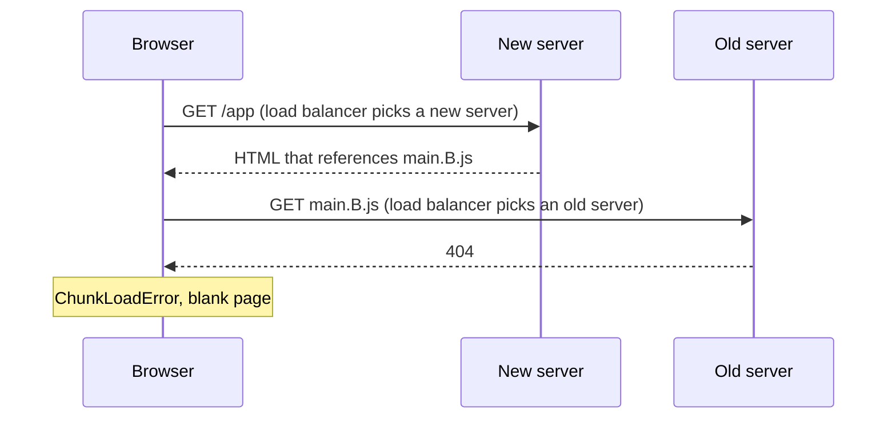
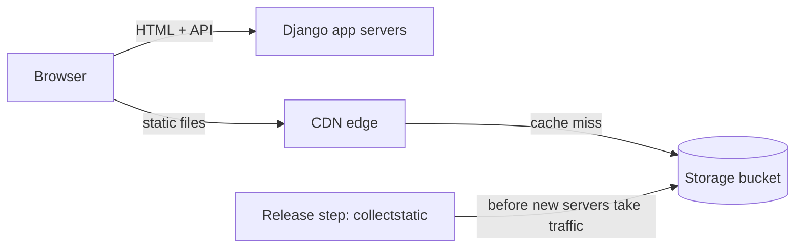

My team's Django app serves a React single-page app. Django renders the HTML shell, and [WhiteNoise](https://whitenoise.readthedocs.io/en/stable/django.html) served the JavaScript and CSS from the same app servers:

```python
STORAGES = {
    # ...
    "staticfiles": {
        "BACKEND": "whitenoise.storage.CompressedManifestStaticFilesStorage",
    },
}
```

That worked until our hosting platform moved us to rolling deploys. From then on, some users got a blank page during every deploy. The problem has a name, version skew, and the fix is to take static files out of the deploy entirely.

## Version Skew in a Rolling Deploy

A rolling deploy replaces servers a few at a time, so old and new releases serve traffic side by side for several minutes. The load balancer routes every request independently.

Webpack gives each build's files content-hashed names, like `main.A.js` and `main.B.js`, so browsers can cache them forever. But each server only has its own release's files:



The reverse fails the same way: old HTML asks a new server for `main.A.js`.

Open tabs are the hardest case. With code splitting, the app loads chunks lazily as the user navigates, so a tab opened before the deploy requests `chunk.A.js` long after every old server is gone. Any app that lazy-loads code has to handle this, whatever its architecture.

## Fixes That Don't Work on Their Own

- **Sticky sessions.** The load balancer pins each browser to one server with a cookie. That makes the bug rarer, not gone: the first request isn't pinned yet, a deploy replaces the server you're pinned to, and open tabs still ask new servers for old files.
- **Blue-green deploys.** Start a full new fleet, then switch all traffic at once. The overlap almost disappears, but open tabs still break after the switch, and every deploy pays for two fleets, database connections included.
- **Reloading on `ChunkLoadError`.** Catch the error and reload the page. It's a good safety net for flaky networks, but it throws away the user's state, and mid-rollout the reload can land on the wrong server again.
- **Deploying the frontend separately.** Moving the single-page app to a static host takes Django out of the picture, but the problem moves with it. The host still has to keep old files for open tabs, and [some hosts delete them on every deploy](https://answers.netlify.com/t/support-guide-handling-code-splitting-issues-on-netlify/113158). You also take on a second deploy pipeline.
- **A CDN in front of the app servers.** [WhiteNoise's docs](https://whitenoise.readthedocs.io/en/stable/django.html#use-a-content-delivery-network) recommend it, and it gets close. But a cache miss for `main.B.js` still goes to whichever server the load balancer picks, and CloudFront [caches that 404](https://docs.aws.amazon.com/AmazonCloudFront/latest/DeveloperGuide/HTTPStatusCodes.html) for 10 seconds by default, for everyone at that edge.

The CDN isn't the problem. Where the files live is.

## Keep Every Build's Files in Shared Storage

Take static files out of the deploy. Every release uploads its files to shared storage: one bucket that every release writes to and every request reads from, which outlives any single release. A CDN serves the bucket. Two rules make it work:

1. Upload in a release step that runs before any new server takes traffic, so new HTML never references a file that isn't there yet.
2. Never delete old files, so old HTML and open tabs always find theirs.



Content-hashed names pay off here. A file that didn't change keeps its name across releases, so it's never re-uploaded and browsers keep it cached. Per-release folders (`/static/<release>/main.js`) also work with shared storage, but every deploy changes every URL, so users re-download everything.

Don't add an expiration rule. S3 [lifecycle rules](https://docs.aws.amazon.com/AmazonS3/latest/userguide/intro-lifecycle-rules.html) expire objects by upload age, and an unchanged file is never re-uploaded, so an age-based rule would delete files the current build still uses. Keeping everything costs pennies a month.

## The Django Side

`STATIC_URL` becomes the switch. An absolute URL means "upload to the bucket and serve from the CDN". A relative one keeps Django's defaults, so local development needs no bucket.

```python
import os
from urllib.parse import urlparse

STATIC_URL = os.environ["STATIC_URL"]  # "https://static.example.com/" or "/static/"
STATICFILES_DIRS = [("bundles", BASE_DIR / "frontend" / "dist")]  # webpack output

STORAGES = {
    "default": {"BACKEND": "django.core.files.storage.FileSystemStorage"},
    "staticfiles": {"BACKEND": "django.contrib.staticfiles.storage.StaticFilesStorage"},
}

if urlparse(STATIC_URL).netloc:
    STORAGES["staticfiles"] = {"BACKEND": "config.storage.StaticStorage"}
    INSTALLED_APPS.insert(0, "collectfasta")  # before django.contrib.staticfiles
    COLLECTFASTA_STRATEGY = "collectfasta.strategies.boto3.Boto3ManifestMemoryStrategy"
    COLLECTFASTA_THREADS = 10
```

`StaticStorage` (below) builds on [django-storages](https://django-storages.readthedocs.io/en/latest/backends/amazon-S3.html)' `S3ManifestStaticStorage`. That ties you to the S3 API, not to AWS: [S3-compatible storage](https://django-storages.readthedocs.io/en/latest/backends/s3_compatible/index.html) like Cloudflare R2 works too.

Stock `collectstatic` is slow against a bucket. It decides what to upload by file modification time, and a fresh CI build gives every file a new one, so it re-uploads everything, one file at a time. [collectfasta](https://github.com/jasongi/collectfasta) compares content hashes instead and uploads in parallel. A typical deploy now uploads only the files that changed, in seconds instead of over an hour. It replaces the `collectstatic` command, which is why it has to come before `django.contrib.staticfiles`.

### The Manifest Is Shared Too

One Django gotcha remains. [`ManifestStaticFilesStorage`](https://docs.djangoproject.com/en/6.1/ref/contrib/staticfiles/#manifeststaticfilesstorage) keeps its manifest, `staticfiles.json`, in the bucket, and every deploy overwrites it. If a worker on an old server restarts mid-deploy, it loads the new manifest, can't find its old bundle's name, and raises `Missing staticfiles manifest entry`: a 500. Webpack already hashes its files, so skip the manifest for them:

```python
# config/storage.py
from urllib.parse import urlparse

from django.conf import settings
from storages.backends.s3 import S3ManifestStaticStorage


class StaticStorage(S3ManifestStaticStorage):
    bucket_name = settings.STATIC_BUCKET_NAME
    custom_domain = urlparse(settings.STATIC_URL).netloc

    def stored_name(self, name):
        if name.startswith("bundles/"):  # already hashed by webpack
            return name
        return super().stored_name(name)
```

Django's own files still go through the manifest. That's safe, because they're looked up by names that don't change between releases.

## Serving It From CloudFront

We already ran CloudFront for another asset domain, so we reused it. Any CDN that can serve a bucket works, since Django only sees `STATIC_URL`. The settings worth getting right:

- **Private bucket.** Block public access and let only the distribution read it, with [Origin Access Control](https://docs.aws.amazon.com/AmazonCloudFront/latest/DeveloperGuide/private-content-restricting-access-to-s3.html).
- **HTTPS only.** Redirect HTTP to HTTPS and require TLS 1.2 or newer.
- **Compression and edge caching.** Turn on compression and use the managed [`CachingOptimized`](https://docs.aws.amazon.com/AmazonCloudFront/latest/DeveloperGuide/using-managed-cache-policies.html#managed-cache-caching-optimized) policy, which caches Brotli and gzip versions at the edge.
- **Long browser caching.** Serve hashed files with `Cache-Control: public, max-age=31536000, immutable` so repeat visits skip revalidation. The cache policy only controls the edge, so set this header on the objects or with a response headers policy.
- **CORS for fonts.** Browsers fetch cross-origin fonts with CORS, so add the headers with a [managed response headers policy](https://docs.aws.amazon.com/AmazonCloudFront/latest/DeveloperGuide/using-managed-response-headers-policies.html).
- **No invalidations.** New content always gets a new name, so a deploy never has to purge the cache.

## What's Next

This fixes skew for static files, not for your API. Mid-rollout, new frontend code can still call an endpoint that old servers don't have yet, so keep API changes backward compatible across a release.

Next for us is infrastructure as code. Defining the bucket, distribution, and DNS records in a tool like Terraform makes every environment identical and every change reviewable.

The short version: upload every build's files to shared storage before the release takes traffic, never delete them, and let the CDN do the rest.
